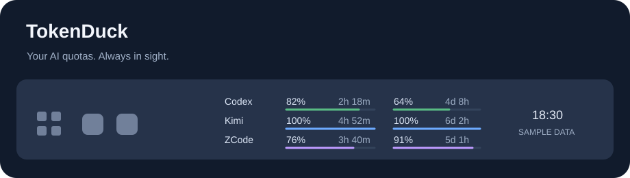

# TokenDuck 🦆

**Always-visible AI subscription quotas in your Windows taskbar.**

[Download for Windows](https://github.com/ShellLayer/tokenduck/releases/latest) · [中文](README.md)

TokenDuck keeps remaining **Codex, Kimi, and GLM Coding Plan / ZCode** quotas and reset countdowns visible together. No click is needed to reveal quotas. The main widget has no separate taskbar button or Alt+Tab entry.



*Illustration with sample data; actual appearance varies with theme, scaling and settings.*

## Get started

1. Download `TokenDuck-VERSION-windows.zip` from [Releases](https://github.com/ShellLayer/tokenduck/releases/latest).
2. Extract it to a permanent folder and run `TokenDuck.exe`. Python and administrator rights are not required.
3. Right-click the widget and choose **账户与登录…** (Accounts & login). Use **开机启动** to enable startup.

The current UI is primarily Chinese. Tested on **Windows 11 x64**. Windows 10, other architectures, vertical taskbars and multi-monitor combinations have not been fully validated. Binaries are currently unsigned; SHA-256 checksums are provided with each release.

Left-click refreshes; hover shows details; right-click opens account, display and startup settings. Percentages show **remaining** allowance. Active unused Kimi windows display `100%`. Failed refreshes keep the last reading muted and marked `*`.

The hover flyout uses provider cards with side-by-side quota bars, reset times, plans and update status. It follows the light or dark theme, stays open when the pointer enters it, and scrolls when the monitor has limited space.

## Account connections

| Service | Connection |
| --- | --- |
| Codex / ChatGPT | Read the official local Codex login; invoke the official login flow when requested |
| Kimi | Prefer the desktop login and attempt to create an independent session; optional browser connection or an existing Kimi Code key |
| GLM Coding Plan / ZCode | Read local ZCode plan credentials or use an existing BigModel / Z.ai plan key |

TokenDuck does not collect passwords or add a telemetry backend. Its own saved credentials are encrypted with Windows current-user DPAPI. It does not refresh the official Codex client's tokens or consume a borrowed Kimi refresh token. Browser import is disabled by default. Switching a bound Kimi account requires an explicit action and successful quota validation. See [privacy details](docs/PRIVACY.md) (Chinese).

This project is independent of the providers. Quota endpoints and local client formats may change. Subscription quotas are not API billing balances or universal token counts.

## Develop

Runtime dependencies are Python's standard library, including Tkinter. Python 3.14 x64 is recommended; development was validated with Python 3.14.10.

```powershell
python tokenduck.py
python -B -m unittest discover -s tests -v
python tokenduck.py --self-check
./build.ps1
```

Tests use synthetic accounts and temporary files. The build script outputs the executable, portable ZIP, checksums and license texts. See [development notes](docs/DEVELOPMENT.md).

Existing pre-TokenDuck users keep their previous data directory and startup entry; fresh installs use `%APPDATA%\tokenduck`. No credential copy is needed during the rename.

[Contributing](CONTRIBUTING.md) · [Security](SECURITY.md) · [MIT License](LICENSE) · [Third-party notices](THIRD_PARTY_NOTICES.md)
