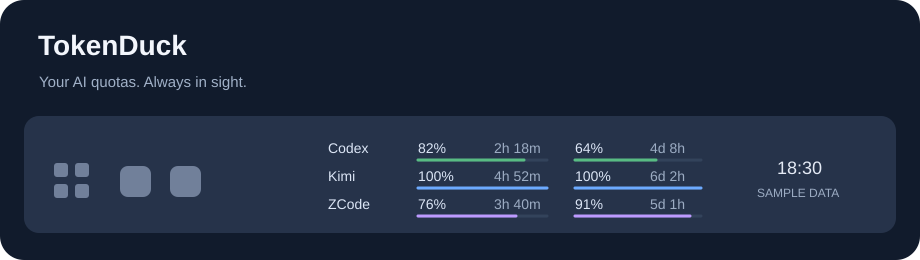

<p align="center"></p>
<h1 align="center">TokenDuck 🦆</h1>
<p align="center">AI 额度，一眼就有数。<br>Always-visible AI subscription quotas in your Windows taskbar.</p>
<p align="center"><a href="https://github.com/ShellLayer/tokenduck/releases/latest">下载 Windows 版</a> · <a href="docs/USAGE.md">使用指南</a> · <a href="docs/PRIVACY.md">隐私与账号保护</a> · <a href="README.en.md">English</a></p>

TokenDuck 将 **Codex、Kimi 和 GLM Coding Plan / ZCode** 的额度与重置倒计时常驻显示在 Windows 任务栏上，可统一选择显示剩余或已用。无需点击展开，也没有长期占用任务栏的独立窗口按钮。

<p align="center"></p>

*上图为显示示意，使用示例数据；实际大小、颜色和位置随系统主题、缩放及设置变化。*

## 特点

- **一眼可见**：三家额度、进度条和重置倒计时同时显示。
- **统一显示方式**：设置中用两个按钮选择剩余额度或已用额度，任务栏、进度条和右键详情同步切换。
- **满额也显示**：Kimi 未使用的有效额度窗口显示 `100%`。
- **显示状态明确**：刷新失败时旧数据置灰并标 `*`；右键查看原因和最后成功时间。
- **右键详情**：按平台显示月总额度、套餐、到期和异常；Kimi 总额度排在前面。Codex 到期日来自匹配账号的本机官方登录记录。
- **月额度补充**：Kimi 总额度的百分比、实际数量和重置时间可在右键菜单查看，跟随剩余／已用设置切换。
- **轻量常驻**：跟随任务栏主题，可调字号、位置和刷新间隔；主额度窗口不出现在 Alt+Tab 中。
- **本地连接**：复用官方客户端的本机登录，或手动添加已有套餐 key；工具自己的凭证使用 Windows 当前用户加密。
- **免安装**：解压即用，不需要另装 Python，不要求管理员权限。

## 下载与运行

1. 前往 [Releases](https://github.com/ShellLayer/tokenduck/releases/latest)，下载 `TokenDuck-版本号-windows.zip`。
2. 解压到固定目录，双击 `TokenDuck.exe`。
3. 右键额度区域，打开“账户与登录…”配置订阅，需要时勾选“开机启动”。

当前版本面向 **Windows 11 x64**，界面以中文为主。Windows 10、其他架构、竖向任务栏及多显示器组合尚未完整验证。程序暂未进行代码签名，Windows 可能显示发布者提示；可对照 Release 中的 SHA-256 校验文件核对下载内容。

## 使用

| 操作 | 效果 |
| --- | --- |
| 右键额度区域 | 查看总额度、套餐、到期和连接异常等补充信息 |
| 右键 → 账户与登录… | 连接、重登或切换账号 |
| 右键 → 显示与刷新设置… | 调整字号、位置与刷新间隔 |
| 右键 → 立即刷新 | 手动更新额度 |
| 右键 → 开机启动 / 退出 | 管理常驻运行 |

默认显示**剩余额度**：`100%` 为未使用，`0%` 为已用完。可在右键“显示与刷新设置…”中改为**已用额度**，此时 `0%` 为未使用、`100%` 为已用完。任务栏的“余 / 用”标记和右键详情标明当前口径，进度条同步切换；告警颜色始终由实际余量决定。

窗口通常为 5 小时和周额度，具体以服务端返回为准；只有月额度时也会显示。它不是 API 消费金额或通用 token 计数器。定时刷新与右键手动刷新均可用。

GLM 的 5 小时额度动态恢复，接口未提供准确时间时显示“已满／未用”或“滚动”，缺少时间的旧记录显示“待刷新”；有准确时间时才显示恢复倒计时。右键可查看恢复说明，详见[使用指南](docs/USAGE.md)。

## 支持的订阅

| 服务 | 获取方式 |
| --- | --- |
| Codex / ChatGPT | 读取官方 Codex 本机登录；需要重登时调用官方登录流程 |
| Kimi | 优先读取 Kimi 桌面端登录并尝试建立独立会话；支持主动选择浏览器连接或已有 Kimi Code key |
| GLM Coding Plan / ZCode | 读取本机 ZCode 的套餐凭证，或使用已有 BigModel / Z.ai 套餐 key |

TokenDuck 不接收账号密码。需要验证时，请在官方客户端或官方网页自行完成。Kimi 绑定账号后不会随浏览器换号而自动切换；导入新账号需主动操作并通过额度验证。浏览器连接默认关闭。

订阅额度接口及本机登录格式可能随供应商更新变化，连接方式存在失效的可能。本项目与 OpenAI、Moonshot AI、智谱或 Z.ai 没有隶属或官方合作关系。

## 开发

运行时仅使用 Python 标准库。建议使用 Python 3.14 x64，包含 Tkinter；已在 Python 3.14.10 / Windows 11 x64 上验证。

```powershell
python tokenduck.py
python -B -m unittest discover -s tests -v
python tokenduck.py --self-check
./build.ps1
```

离线测试使用合成账号和临时文件，不请求真实账号接口。`--self-check` 检查本机加密、重定向保护、满额显示及窗口样式；详细说明见[开发指南](docs/DEVELOPMENT.md)。

从早期 CodexBar 版本升级时，会原地复用旧数据和自启入口，避免重新导入凭证；新安装默认使用 `%APPDATA%\tokenduck`。[使用指南](docs/USAGE.md)解释了数据位置和卸载方式。

## 参与与许可

欢迎提交 [Issue](https://github.com/ShellLayer/tokenduck/issues) 或 Pull Request。反馈前请阅读[参与说明](CONTRIBUTING.md)，不要上传登录文件、key、Cookie 或完整账号日志。安全问题请参见 [SECURITY.md](SECURITY.md)。

[MIT License](LICENSE)。运行库许可及互操作参考见 [THIRD_PARTY_NOTICES.md](THIRD_PARTY_NOTICES.md)。
